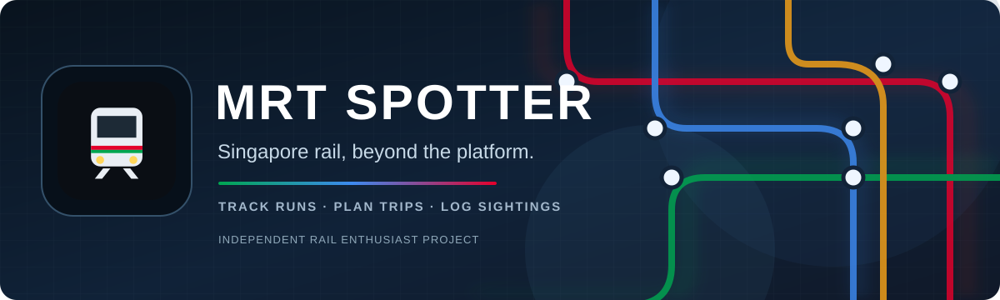

 

**More than a next-train timer. A deeper look at Singapore's MRT and LRT network.**

MRT Spotter is an independent, fan-made rail companion for **train enthusiasts**, curious commuters and everyone who wants to explore how the network operates.

 

**Singapore MRT • LRT • Train runs • Spotting • Journey planning**

## 📚 Explore the project

| **[🚆 Feature guide](docs/features.md)** | **[📷 Screenshot showcase](docs/screenshots.md)** | **[❓ FAQ & data accuracy](docs/faq.md)** |
|:---|:---|:---|
| Maps, Line Board, train runs and spotting tools | Guide to authentic public-app captures | Timetable vs estimated positions, run numbers and duty terms |

**[Documentation hub](docs/README.md)** · **[Contributing](CONTRIBUTING.md)** · **[Report a correction](https://github.com/dannyiswandyy/Mrt-app/issues/new/choose)** · **[Data sources](docs/data-sources.md)**

---

## 🚆 Why MRT Spotter?

Most journey apps tell you *when* your train should arrive. **MRT Spotter explores the service behind that arrival:** scheduled train slots, where a run goes next, short trips and turnbacks, how trains move across the network, and the information that makes train spotting more interesting.

| 🗺️ **Explore the network** | 🔢 **Follow train runs** | 📷 **Make every sighting count** |
|:---|:---|:---|
| Navigate Singapore's MRT/LRT network on an interactive map, with each line's trains, stations, interchange codes and nearby building outlines where data is available. | Open train journeys, view scheduled slot/run numbers, inspect trip sequences and check short workings, turnbacks and late-night duties. | Log **Spotted** or **Rode** from a train sheet, keep a record of sightings and see your own sighting markers on the maps for the service day. |

## 🔎 Built for Singapore rail enthusiasts

### 🚉 Line Board & train journeys
See more than an arrival countdown. Explore a line's train information, station stops, directions, next departures and first/last services. Open a train's journey to look at its scheduled movements and remaining trips, including services that terminate short of the line's end.

### 📋 Spotter Planner
Choose a **line, station, date and time window** to find scheduled train movements. Depending on the available timetable data, the planner can show slot numbers, direction, terminal station, platform, first/last and short-trip indicators, and when a run is due back at the station. For curious spotters, GTFS trip identifiers are available too.

### 🔁 Run graph & rail intelligence
Explore how scheduled trips are linked together into train duties and get context around service patterns, rotations and disruptions. The app distinguishes timetable evidence and inferences; it does **not** treat a run number as proof of a particular physical trainset.

### 📝 Train spotting & rolling stock
Record sightings, revisit your log and explore rolling-stock information and photographs where available. Trainset-related information derived from logged sightings is evidence-based and may be incomplete.

### 🌍 Your railway, on a map
Search for stations, open station information cards and follow the map's direction-of-travel arrows. Building outlines and track geometry are packed from OpenStreetMap during the build and may vary with data availability.

## ✨ More than spotting

| Feature | What you can do |
|:---|:---|
| 🧭 **Trip planner** | Compare train routes with transfers, next departures, estimated journey duration, fares and the route shown on the map. |
| 🕐 **Next trains** | Check station arrival estimates, save favourite stations and use the Android home-screen widget for a saved station. |
| 🚦 **Service updates** | View disruption information, crowd information and rail news when their data sources are available. |
| 🌦️ **Weather on the map** | See Singapore weather information from NEA / data.gov.sg, including map effects where supported. |
| 📺 **RailCam** | Watch the RailCam Singapore YouTube stream through the Live cam section, subject to stream availability. |
| 🚌 **Bus information** | Explore bus arrival information available in the public app. |
| 💬 **Ask MRT Spotter** | Ask questions about Singapore rail using built-in app information; AI-assisted answers depend on configuration. |
| 🔔 **Useful reminders** | Android trip reminders, saved-line disruption notifications and in-app update checking. |
| 📶 **Resilient offline experience** | Continue using packaged timetables and previously cached map resources when network connectivity is limited. Some live features still require an internet connection. |

## 📲 Try it now

| **Android app** | **Web app** |
|:---|:---|
| **[Download the latest APK](https://github.com/dannyiswandyy/Mrt-app/releases/download/latest/mrt-tracker.apk)** | **[Open MRT Spotter in your browser](https://dannyiswandyy.github.io/Mrt-app/)** |
| Open the APK on your Android phone to install. Future public releases can be checked from inside the app. | No install is needed. You can also add the website to your home screen on supported browsers. |
| Includes phone-specific functions such as widgets, notifications and trip reminders. | Shares the core public map, timetable, spotting and planning experience; phone-only features are omitted. |

> [!NOTE]
> MRT Spotter is distributed as a **public beta / enthusiast project**, not as an official public-transport application. The website and Android app aim to share the same public features, but browser permissions, data access and device capabilities can affect what is shown.

## 🧠 Where do the train timings come from?

MRT Spotter uses **LTA's GTFS train timetable** when a suitable packed timetable is available. If that data cannot be used, the app can fall back to estimates informed by known train duty rosters and operating patterns.

- **Scheduled slot / run number ≠ physical fleet or trainset ID.** The slot represents a duty in the timetable, not confirmation of which trainset is operating it.
- A train arrow or arrival estimate may be **timetable-derived or inferred**, rather than a continuously measured live GPS position.
- Duty descriptions can include **FD (full day), HD (half day), AM peak, PM peak, OP (off-peak) and LN (late night)**. Combinations such as **FD LN** or **OP LN** describe operating patterns and are interpreted from available timing evidence.
- Sightings can provide additional user-entered evidence, but cannot guarantee the real-time location or identity of a train.
- Future stations, incomplete rail geometry, temporary operating changes and special services may not be reflected accurately until supported data is available.

**Use MRT Spotter as an enthusiast and journey-planning companion, and verify important journeys with official transport sources.**

<b>🛠️ For developers and contributors — project structure</b>

 

This is the **public** MRT Spotter repository. The Android app and website use the same core public page.

| Path | Purpose |
|:---|:---|
| [`web/index.html`](web/index.html) | Main public MRT Spotter interface |
| [`web/spotter-planner.js`](web/spotter-planner.js) | Timetable-based spotter planning |
| [`web/run-graph.js`](web/run-graph.js) | Scheduled run and trip linkage |
| [`web/trainset-intelligence.js`](web/trainset-intelligence.js) | Sighting-based trainset evidence |
| [`web/bus.js`](web/bus.js) | Bus arrivals module |
| [`tools/`](tools) | Build-time timetable, track, station and building data preparation |
| [`.github/workflows/build-android.yml`](.github/workflows/build-android.yml) | Public Android build and release |
| [`.github/workflows/deploy-web.yml`](.github/workflows/deploy-web.yml) | GitHub Pages deployment |
| [`.github/workflows/timetable-check.yml`](.github/workflows/timetable-check.yml) | Timetable and service-pattern checks |
| [`worker/`](worker) | Optional data relay and its configuration |
| [`web/README.md`](web/README.md) | Website setup and platform-specific details |
| [`AGENTS.md`](AGENTS.md) | Repository safety and contribution guidelines |

Data may be packed during builds and is not necessarily committed as a browsable file. Build outputs should report when source downloads fail or a fallback is used.

**Do not commit API keys, tokens or other credentials.** Follow [`AGENTS.md`](AGENTS.md) before modifying the public app or release pipeline.

<b>🗂️ Data sources, credits and attribution</b>

 

MRT Spotter draws upon or references the following sources where relevant and available:

- **Land Transport Authority (LTA)** — timetable and related rail data / service information.
- **National Environment Agency (NEA)** via **data.gov.sg** — weather information.
- **OpenStreetMap contributors** — map features, some building data and track geometry.
- **SMRT** and **SBS Transit** — publicly available rail operations and service information.
- **RailCam Singapore** — YouTube live-camera content, with credit to its owner.
- Other third-party rail reference material, imagery and attributions as identified in the app.

Photographs, logos, fonts, geographic data and other third-party assets remain subject to the rights and conditions of their respective owners. Their presence in the project does not grant redistribution or commercial-use permission.

## 💬 Feedback & community

Found an incorrect train slot, an unusual working, a station detail that needs correcting, or a UI issue? **[Open a GitHub issue](https://github.com/dannyiswandyy/Mrt-app/issues)** with the line, station, date, time and screenshot if possible. Clear reports help improve the tracker.

If you enjoy exploring Singapore rail, consider **starring this repository** to support the project. ⭐

---

**Made for the people who notice every train, every turnback and every unusual working.**

[🌐 Web app](https://dannyiswandyy.github.io/Mrt-app/) · [📥 Android APK](https://github.com/dannyiswandyy/Mrt-app/releases/latest) · [🐛 Report an issue](https://github.com/dannyiswandyy/Mrt-app/issues)

MRT Spotter is an independent fan project. It is not affiliated with or endorsed by LTA, SMRT, SBS Transit or other transport operators. Schedules, predicted positions, service conditions and other information may be delayed, incomplete or inaccurate. Always check official sources for time-critical travel decisions.

